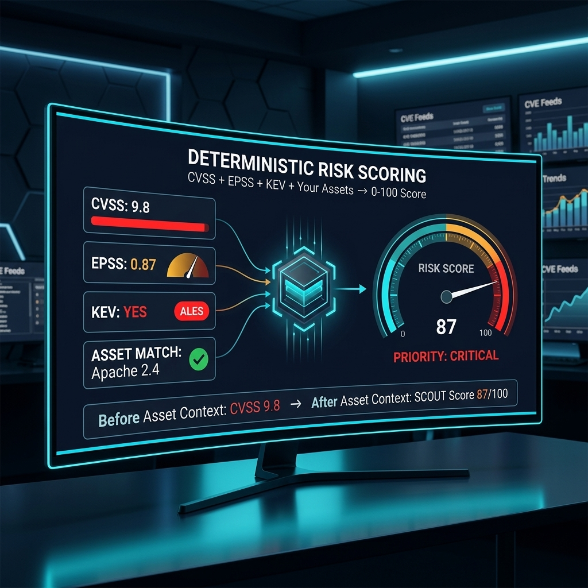
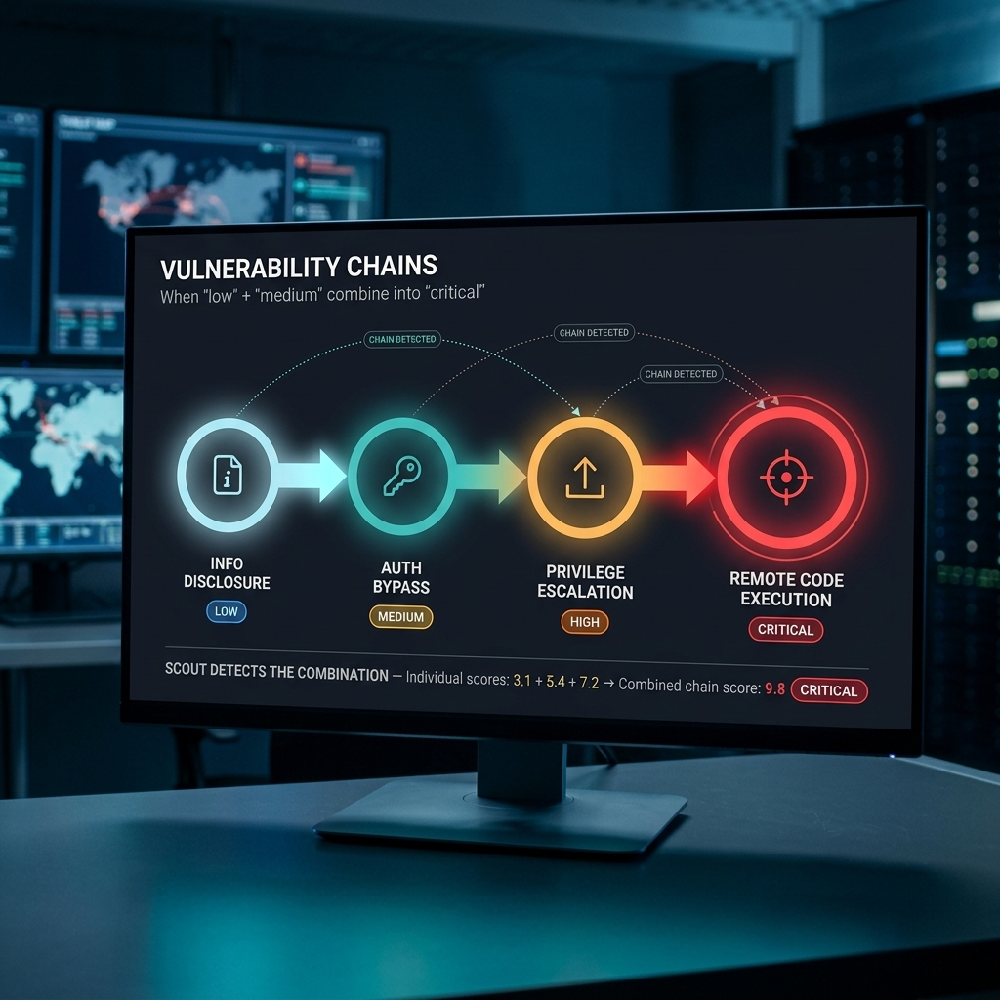
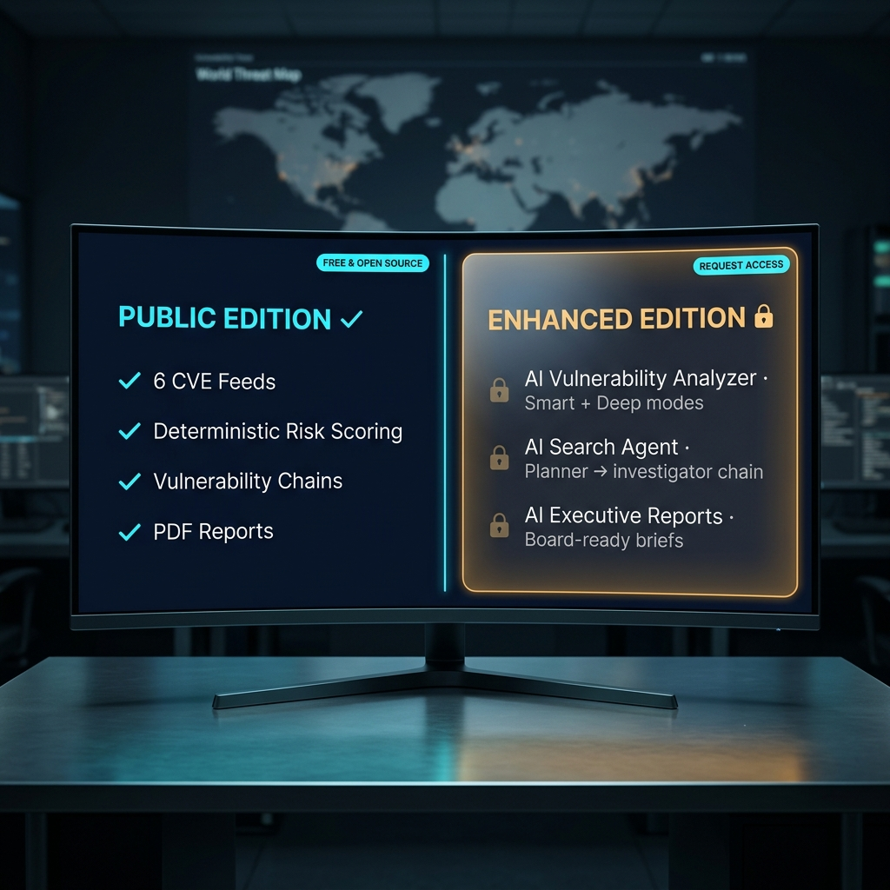

# SCOUT

### **S**ecurity **C**VE & **O**utbreak **U**niversal **T**racker

**The vulnerability intelligence dashboard that scores CVEs against *your* assets — not generic CVSS.**

[](#download)
[](LICENSE)
[](#security--verification)
[](#features-public-edition)

---

> 💎 **Looking for more?** This is the **Public Edition** — free for personal, educational, and non-commercial use. The **Enhanced Edition** unlocks AI-powered workflows, advanced threat-intelligence modules, **commercial-use licensing**, and priority support. See the [full comparison ↓](#public-edition-vs-enhanced-edition).

## The problem SCOUT solves

Vulnerability management is broken by volume:

- 📊 **50+ new CVEs published per day** across NVD, CISA, ExploitDB, GitHub Advisories, OSV
- ❓ **Generic CVSS scores tell you nothing about *your* exposure** — a 9.8 RCE in a library you don't use is a 0.0 for you
- 🔍 **Hours of manual research per critical** — pivot through NIST → ExploitDB → vendor advisory → MITRE ATT&CK → your CMDB
- 📝 **Stakeholder reporting eats half your week** — translating tech-speak into board language
- 🚨 **Alert fatigue causes real misses** — when everything is "critical", nothing is

The result: small security teams drown. Big enterprise tools (Tenable, Qualys, Rapid7) start at $30K/year and assume you have a dedicated VM program. There's a huge gap in the middle.

SCOUT fills it.

---

## What it does

```
CVE Published → Auto-Ingested → Asset-Scored → Chained → Alerts Sent → Reports Generated
   (6 feeds)      (real-time)     (0-100)       (RCE path) (email/push)   (PDF/IOC)
```

- Pulls feeds from **6 vulnerability sources** in real time
- Scores each CVE against **your declared asset inventory** — not just generic CVSS
- Maps **vulnerability chains** that combine into higher-severity attack paths
- Sends **alerts** (email + desktop push) when something hits your stack
- Generates **PDF reports** for stakeholders

Result: your team only acts on what actually threatens *your* infrastructure.

---

## Download

| File | What it is |
|---|---|
| [`SCOUT-Portable-v1.0.0-windows.7z.001`](SCOUT-Portable-v1.0.0-windows.7z.001) | Multi-volume archive part 1 of 2 |
| [`SCOUT-Portable-v1.0.0-windows.7z.002`](SCOUT-Portable-v1.0.0-windows.7z.002) | Multi-volume archive part 2 of 2 |

**To extract:** download **both parts** into the same folder, then right-click `SCOUT-Portable-v1.0.0-windows.7z.001` → **7-Zip → Extract Here**. 7-Zip auto-detects both parts and produces the portable folder containing `SCOUT.exe`. ([Get 7-Zip free here](https://www.7-zip.org/) if you don't have it.)

`.sigstore.json` signature alongside each part — see [Security & Verification](#security--verification).

---

## Quick Start

1. Extract the archive (both `.7z` parts — see **Download** above) to a folder of your choice.
2. Double-click **`SCOUT.exe`**.
3. Log in with the default credentials:
   - **Username:** `admin`
   - **Password:** `admin123`

> ⚠ Change the default password immediately via **Settings → User Account**.

### First-time setup

1. **Settings → Assets** — declare the software, vendors, and platforms in your environment so risk scoring is meaningful
2. **Settings → Alerts** — wire up email (SMTP) and / or desktop notifications
3. **Settings → Feeds** — enable / disable the CVE sources you care about

That's it. SCOUT starts pulling feeds immediately.


---

## Features (Public Edition)

- **6 CVE feeds** in parallel: NVD, CISA Known Exploited Vulns, ExploitDB, GitHub Advisories, OSV, generic RSS
- **Deterministic risk scoring** — combines CVSS, EPSS, KEV status, and your asset config into a single 0–100 score
- **Vulnerability chains** — automatic detection of CVE combinations that escalate to RCE / privilege escalation
- **Real-time alerts** — email (SMTP) + Windows desktop push when matching CVEs publish
- **PDF reports** — stakeholder-ready vulnerability briefs with executive summary, technical detail, and remediation timeline
- **IOC export** — feed your SIEM / EDR with chain artifacts
- **MITRE ATT&CK mapping** — every CVE annotated with relevant techniques and tactics
- **100% offline-capable** — feeds can be cached for air-gapped use
- **Single-binary deploy** — no SQL Server, no Redis, no Kubernetes; SQLite under the hood






---

## How does SCOUT compare?

| Capability | SCOUT (Public) | Tenable Nessus / VMDR | Qualys VMDR | Rapid7 InsightVM | Vulners | Snyk |
|---|:---:|:---:|:---:|:---:|:---:|:---:|
| **Cost** | Free (non-commercial) | $4K-$50K/yr | $30K+/yr | $30K+/yr | Free / $$ | Free / $$ |
| **Setup time** | 2 minutes | Hours-Days | Days | Days | Minutes | Minutes |
| **Multi-feed aggregation (6 sources)** | ✅ | ⚠️ Tenable feed only | ⚠️ Qualys feed only | ⚠️ Rapid7 feed | ✅ | ⚠️ Snyk DB |
| **Asset-aware risk scoring (vs generic CVSS)** | ✅ | ✅ | ✅ | ✅ | ❌ | ✅ (code-only) |
| **Vulnerability chain detection** | ✅ | ⚠️ Limited | ⚠️ Limited | ✅ | ❌ | ❌ |
| **CISA KEV integration** | ✅ | ✅ | ✅ | ✅ | ✅ | ⚠️ |
| **MITRE ATT&CK mapping** | ✅ | ✅ | ✅ | ✅ | ⚠️ | ❌ |
| **PDF report generation** | ✅ | ✅ | ✅ | ✅ | ❌ | ⚠️ |
| **Active scanning (network)** | ❌ | ✅ | ✅ | ✅ | ❌ | ❌ |
| **Desktop, no server required** | ✅ | ❌ Cloud / appliance | ❌ Cloud | ❌ Console | ⚠️ Web | ⚠️ Web |
| **Offline / air-gapped** | ✅ | ⚠️ Limited | ❌ | ⚠️ | ❌ | ❌ |
| **AI vulnerability analysis** | (Enhanced) | ⚠️ Add-on | ✅ | ⚠️ | ❌ | ⚠️ |
| **Learning curve** | Hours | Days | Days | Days | Hours | Hours |

**Bottom line:** SCOUT is a **CVE intelligence + prioritisation** tool, NOT an active network scanner. It complements (rather than replaces) Nessus / Qualys / Rapid7 if you already have those. If you don't — and most teams under 50 people don't — SCOUT gives you 70% of the value (intelligence + scoring + reporting) at $0. The remaining 30% (active scanning, agent-based asset discovery) you can layer in later if you grow.

---

## Real-world use cases

### Case 1 — Small-team vulnerability management
A 5-person security team at a 200-person SaaS company. No budget for Tenable. They use SCOUT to:
- Declare their stack (AWS, Postgres, Node.js, Kubernetes, specific library versions)
- Get alerted only on CVEs that hit their actual stack
- Generate monthly board reports as PDF
- Skip the 95% of CVE noise that doesn't apply to them

### Case 2 — Patch-Tuesday triage
Microsoft drops 80 CVEs on a Tuesday. SCOUT:
- Ingests them all within an hour of release
- Highlights the 3 that affect declared assets (Windows Server 2022, IIS, Exchange)
- Surfaces 1 that's already in CISA KEV (immediate priority)
- Generates the patching prioritisation report before lunch

### Case 3 — Air-gapped industrial-control environment
A power utility runs SCOUT on an isolated workstation. Feeds are cached on a removable drive once a week, ingested into SCOUT offline. The team gets vulnerability intelligence for their PLC / SCADA stack without ever connecting the OT network to the internet.

### Case 4 — Vulnerability-chain discovery
SCOUT spots that CVE-X (low-severity info disclosure in Component A) + CVE-Y (high-severity auth bypass in Component B that's deployed behind A) creates a critical RCE chain when combined. Neither CVE looks scary alone — together they're shipping vulnerability.

---

## Public Edition vs Enhanced Edition

| Capability | Public | Enhanced |
|---|:---:|:---:|
| 6 CVE feeds + deterministic risk scoring | ✅ | ✅ |
| Vulnerability chains + MITRE ATT&CK mapping | ✅ | ✅ |
| Email + desktop alerts | ✅ | ✅ |
| PDF reports + IOC export | ✅ | ✅ |
| **AI Vulnerability Analyzer** — LLM summaries with **Smart** (one-shot) and **Deep** (multi-pass) modes; detection-rule tuning suggestions for Splunk / Sentinel / Elastic | — | ✅ |
| **AI Search Agent** — planner → investigator → analyst chain that researches a CVE across feeds, enriches IOCs, and produces a finished briefing autonomously | — | ✅ |
| **AI Executive Reports** — one-click LLM-written stakeholder reports (board-deck quality), pulling from your alerts, chains, and asset risk | — | ✅ |



### Why the Enhanced Edition?

- 🚀 **AI modules the Public Edition can't ship** — AI Vulnerability Analyzer (Smart + Deep modes), AI Search Agent (planner → investigator → analyst chain), AI Executive Reports (board-deck quality)
- 🤖 **From 50 CVEs/day to 5 minutes of triage** — the AI Search Agent autonomously researches each high-impact CVE across feeds and enriches IOCs; you review, you don't investigate
- 🎯 **Commercial-use license included** — the Public Edition excludes paid use; the Enhanced Edition covers MSSP / consultancy / vendor embedding
- 📈 **All future v1.x and v2.x updates included** — including planned D3FEND mapping, SBOM ingest, REST API
- 🛟 **Priority support** — direct email channel, response within 48 hours
- 🛠 **Multi-user / role-based access** — Enhanced supports team installs; Public is single-user
- 🥇 **Early access** — new feeds + scoring models before they go public
- 🏢 **Tailored onboarding** — asset-inventory ingestion from your CMDB, custom alert routing, on-prem deployment

### Get the Enhanced Edition

- 📧 Email: [mathan1702@gmail.com](mailto:mathan1702@gmail.com)
- 💼 LinkedIn: [linkedin.com/in/mathan-subbiah-0bb47aa8](https://www.linkedin.com/in/mathan-subbiah-0bb47aa8/)
- 🌐 Website: [mathanport.netlify.app](https://mathanport.netlify.app/)

### 🎁 Free for personal use — paid for enterprise

**The Enhanced Edition is given away free of charge for non-commercial use.** Just ask. The following uses qualify and cost nothing:

- 🎓 Students, researchers, classroom teaching, academic papers
- 🏠 Personal projects, hobbyist tinkering, self-hosted home labs
- 🏆 CTFs, security conferences, blue / purple-team training exercises
- 🛡️ Independent security research and bug-bounty hunting

Email or LinkedIn-DM me a one-line description of what you're using it for, and I'll send the Enhanced binary + unlock instructions within 48 hours. No forms, no sales calls, no NDAs.

**Commercial / enterprise use requires a paid licence.** That covers:

- 💼 Paid client engagements (consultancy, MSSP, SOC-as-a-Service, IR retainers)
- 🏢 Deployment inside a for-profit organisation with > 25 employees
- 🧩 Embedding in or bundling with a commercial product / SaaS offering
- 🔁 Resale, sub-licensing, or re-distribution

For commercial enquiries the [contact form on my website](https://mathanport.netlify.app/) is the fastest path; quotes typically returned within 24 hours.

---

## FAQ

**Q: Does SCOUT scan my network?**
No. SCOUT is a CVE-intelligence + prioritisation tool, not an active scanner. It pulls vulnerability advisories from public sources and matches them against the assets *you declare*. To find vulnerabilities by active scanning, you'd pair SCOUT with Nessus / OpenVAS / Nuclei.

**Q: Where does the CVE data come from?**
Six public feeds: NVD (NIST), CISA KEV, ExploitDB, GitHub Advisories (GHSA), OSV (Open Source Vulnerabilities), and configurable RSS feeds. All free and authoritative.

**Q: How does asset-aware scoring work?**
You tell SCOUT what you run (vendors, products, versions). When a CVE comes in, SCOUT checks: "does this CPE / package match anything in your inventory?" If yes, the CVE bumps to the top with full context. If no, it's filed but de-prioritised. Generic CVSS 9.8 + "we don't use that" = 0 on your dashboard.

**Q: What's EPSS and why does SCOUT use it?**
EPSS (Exploit Prediction Scoring System) is a FIRST.org-maintained probability that a CVE will be exploited in the next 30 days. SCOUT blends it with CVSS so you don't waste cycles on theoretical 9.8s that nobody ever exploits.

**Q: Will it work in an air-gapped environment?**
Yes. Cache the feeds on a removable drive (the feeds themselves are small JSON), bring them in, point SCOUT at the cache. The app works fully offline once the feed cache is populated.

**Q: What's the database backend?**
SQLite. No SQL Server / Postgres / Redis to manage. The DB lives in `%APPDATA%\SCOUT\scout.db`.

**Q: Default password is `admin123`?! That's terrible security.**
It's a first-launch convenience. The UI nags you to change it on first login. Change it before exposing SCOUT to anything outside your machine.

**Q: Can multiple analysts share one SCOUT install?**
The public edition is single-user, local-machine. Multi-user with role-based access is a separate offering — email me if that's a need.

**Q: How big does the database get?**
For ~50K CVEs (roughly the NVD historical corpus), expect a 200-300 MB DB. New CVEs add ~1 MB/month.

**Q: Will Windows SmartScreen warn me?**
Yes, on first launch. Click "More info" → "Run anyway". Or verify the Sigstore signature first via `scripts/verify.ps1`.

**Q: Does it work with MITRE D3FEND? With ATT&CK?**
ATT&CK: yes, every CVE annotated with relevant techniques. D3FEND mapping is on the v1.2 roadmap.

---

## Roadmap

- **v1.1** — REST API for headless use; multi-user shared install
- **v1.2** — D3FEND mapping; SBOM ingest (CycloneDX, SPDX)
- **v2.0** — Linux + macOS native builds
- **Enhanced v1.0** — already shipping (contact for licensing)

---

## Security & Verification

Both release archive parts are signed with **Sigstore**, bound to my GitHub identity (`PrototypePrime`), and recorded on the public **Rekor transparency log**.

```powershell
.\scripts\verify.ps1 SCOUT-Portable-v1.0.0-windows.7z.001
.\scripts\verify.ps1 SCOUT-Portable-v1.0.0-windows.7z.002
```

Returns `VERIFIED OK` for each part if its signature matches. Keep each part's `.sigstore.json` file next to it.

Sigstore proves **provenance**, not Windows **Authenticode**. SmartScreen will still warn on first launch.

---

## License

Free for **personal, educational, and non-commercial use**. Commercial use requires a separate license — see [`LICENSE`](LICENSE).

---

<div align="center">

*Built by [Mathan Subbiah](https://mathanport.netlify.app/) — Detection Engineering · Splunk · AI*

[📧 Email](mailto:mathan1702@gmail.com) · [💼 LinkedIn](https://www.linkedin.com/in/mathan-subbiah-0bb47aa8/) · [🌐 Website](https://mathanport.netlify.app/)

</div>

